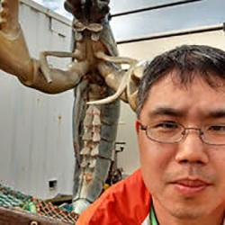

## Overview

::: background-callout
As ocean conditions along the Northeast U.S. shelf continue to change and species shift in distribution and productivity, the communities that rely on fisheries are adapting as well. Geographical shifts in abundance affect where vessels choose to fish, but those choices also depend on other factors, like prices, travel distances, and the regulatory environment. How vessels and dealers respond to these changes will determine the costs of adaptation, and some strategies are more likely to be successful than others. Management institutions shape which of these strategies are available to fishers and dealers and can either attenuate or accentuate these impacts. The NCLIM Human Dimensions team uses economic and social science methods to better understand these decisions and the adaptation pathways available to, and chosen by, these individuals and firms. Our current focus is the commercial fisheries for black sea bass (Centropristis striata) and summer flounder (Paralichthys dentatus) off the U.S. East Coast. In the past five years, fishery managers have updated state allocations to account for changes in the geographic distributions of these two species.
:::

::: callout-note
### Key Objectives

Better understand how commercial fishers decide where to fish, what to target, and where to land their catch as species distributions and ocean conditions change. Examine how ex-vessel prices vary across ports and over time, and how they influence fishing and landing decisions. Explore how existing management measures, such as state-level quotas and trip limits, interact with shifting stocks to affect fishing businesses and communities.
:::

### Current Initiatives

::: background-callout
-   **Estimating the Efficiency Cost of State-Level Quota Allocations:** Estimating the Efficiency Cost of State-Level Quota Allocations As black sea bass and summer flounder become more available further north, state-level quotas and landing restrictions may create a geographic mismatch between the fishing fleet and the fish. We model where federally permitted vessels in these fisheries choose to fish and land, then simulate how landings, revenues, and travel distances might change without state-level quotas and trip limits.
-   **Modeling Consumer Demand:** We estimate spatially disaggregated demand elasticities for black sea bass and summer flounder. Understanding consumer demand at this level of disaggregation is necessary to be able to quantify the general equilibrium effects of changes in patterns of landings on local markets for our species of interest.
-   **Understanding the Costs of State Restrictions:** The model from initiative 1 will be used to simulate counterfactual landing distributions at various time intervals across the sample period. We can compute the aggregate excess steaming distance and associated fuel costs under the observed (constrained) landing patterns relative to the simulated (unconstrained) distributions. This provides a lower bound on the total cost of state borders: it captures transport inefficiency alone. We can decompose these costs by state and vessel home port, characterizing which fleets bear disproportionate burden and how that distribution of costs has shifted as stocks have moved north.
:::

------------------------------------------------------------------------

## Target Audiences & Relevant Processes

::: background-callout
This research examines the effect of market access and environmental change and is directly relevant to National Standards 3, 4, 5, and 8 of the Magnuson Stevens Fishery Conservation and Management Act. It improves understanding of the economic costs that market restrictions impose on fishers and dealers, which is addressed goals to increase utilization and the U.S. seafood supply (E.O. 14276).
:::

::::::::: {.grid .my-4}
::::: {.g-col-12 .g-col-md-6}
:::: {.card .h-100 .shadow-sm}
::: card-body
<h4 class="card-title text-primary">

<i class="bi bi-people-fill me-2"></i>Primary Users & Councils

</h4>

This research may interest economists, political scientists, and fisheries managers at the MAFMC and ASMFC, the East Coast Coordination Group, and other members of the NCLIM project team.

[MAFMC]{.badge .bg-primary .fs-6 .me-1 .mb-2} [ASMFC]{.badge .bg-primary .fs-6 .me-1 .mb-2}
:::
::::
:::::

::::: {.g-col-12 .g-col-md-6}
:::: {.card .h-100 .shadow-sm}
::: card-body
<h4 class="card-title text-primary">

<i class="bi bi-diagram-3-fill me-2"></i>Relevant Processes & Operations

</h4>

Key management frameworks and scientific integration pathways:

-   **Allocation reviews:** The Councils and the ASMFC are required to review allocations periodically, and this work could help clarify the efficiency costs of the current state-level quota allocation system.
-   **Climate scenario planning and coordination:** Economic research on how fishers and markets respond to shifting stocks may inform future [East Coast Climate Change Scenario Planning efforts](https://www.mafmc.org/climate-change-scenario-planning).
-   **Integration with NCLIM:** Over time, we hope to link economic models of seafood markets and fisher and behavior with some of NCLIM’s other ecosystem and stock assessment models.
:::
::::
:::::
:::::::::

------------------------------------------------------------------------

## Project Team

::: background-callout
Our interdisciplinary team brings together experts in applied economics, social science, and quantitative modeling:
:::

::::::::::: {.grid .my-4}
:::::: {.g-col-12 .g-col-sm-6 .g-col-lg-4}
::::: {.card .text-center .h-100 .shadow-sm}
:::: card-body
::: mb-3

:::

<h5 class="card-title mb-1">

Min-Yang Lee

</h5>
::::
:::::
::::::

:::::: {.g-col-12 .g-col-sm-6 .g-col-lg-4}
::::: {.card .text-center .h-100 .shadow-sm}
:::: card-body
::: mb-3

:::

<h5 class="card-title mb-1">

Anna Birkenbach

</h5>
::::
:::::
::::::

:::::: {.g-col-12 .g-col-sm-6 .g-col-lg-4}
::::: {.card .text-center .h-100 .shadow-sm}
:::: card-body
::: mb-3

:::

<h5 class="card-title mb-1">

Stephen Kasperski

</h5>
::::
:::::
::::::

:::::: {.g-col-12 .g-col-sm-6 .g-col-lg-4}
::::: {.card .text-center .h-100 .shadow-sm}
:::: card-body
::: mb-3

:::

<h5 class="card-title mb-1">

Whitney Morgan

</h5>
::::
:::::
::::::
:::::::::::
